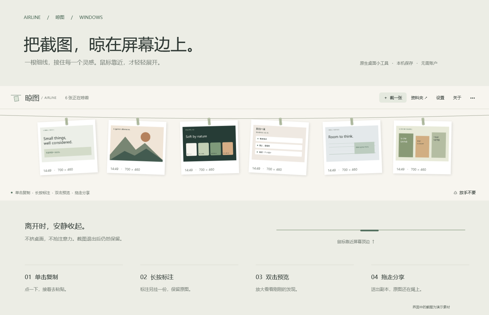
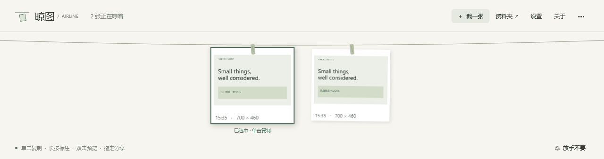
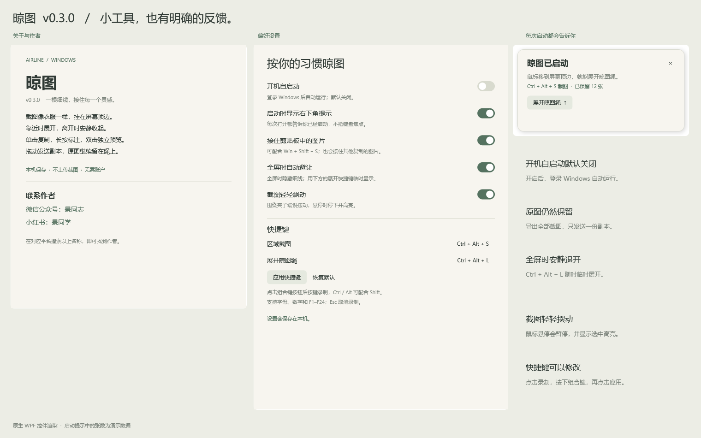
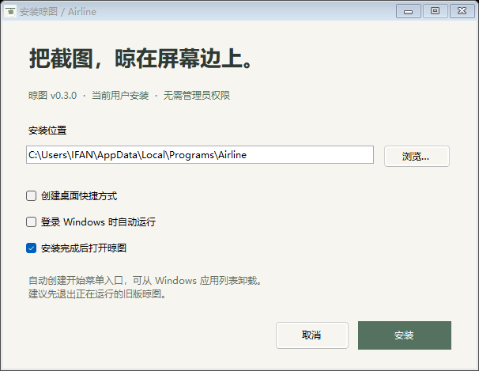

# 晾图 / Airline 📎

> 把截图，晾在屏幕边上。
> 一根细线，接住每一个灵感。鼠标靠近，才轻轻展开。

**晾图**是一个 Windows 原生桌面小工具：屏幕顶端常驻一根"晾图绳"，截图像照片一样夹在上面。不占桌面、不抢注意力，用时展开、离开即收。纯 WPF 实现，没有 Electron，没有浏览器壳。



---

## ✨ 特性

### 🖼️ 晾图绳

- **自动收放**：鼠标移到主屏幕顶端展开（220ms），离开约半秒后收起，只留一条细线
- **分页展示**：不设张数上限，图片按屏幕宽度分页，`‹ / ›` 翻页
- **轻摆动画**：截图悬挂时轻轻摆动，鼠标悬停时暂停（v0.3.0）

### 📸 截图与收集

- **快捷键截图**：默认 `Ctrl + Alt + S` 框选区域，`Esc` 取消；快捷键可在设置中自定义（`Ctrl`/`Alt`/`Shift` 组合）
- **一键展开**：`Ctrl + Alt + L` 或单击托盘图标
- **接住剪贴板**：用 Win + Shift + S 等方式截图后，自动挂上晾图绳（可在设置关闭）

### 🖱️ 每张截图都能做什么

| 操作 | 效果 |
|---|---|
| 单击 | 复制图片 |
| 长按 ~0.55s | 打开标注（画笔、方框、箭头、四色、撤销），标注图另挂一份，原图保留 |
| 双击 | 打开独立大图预览（非模态，不锁晾图绳） |
| 拖到其他 App | 传递 PNG 副本，**原图继续留在绳上** |
| 拖到资源管理器 | 存下 PNG 副本 |
| 拖到"放手不要"角标 / 回收站 | 移入 Windows 回收站，可恢复 |
| 右键 | 复制 / 标注 / 预览 / 另存为 / 放入回收站 |



### ⚙️ v0.2.0+ 实用功能

- **启动反馈**：每次启动右下角显示非激活提示（截图张数 + 快捷键），重复运行不会多开
- **关于与设置窗口**：集中管理偏好，说明作者与联系方式
- **开机自启动**：只写当前用户注册表 `HKCU\...\Run`，无需管理员权限，默认关闭
- **全屏自动避让**：全屏应用时连细线都隐藏，`Ctrl + Alt + L` 可临时展开十秒
- **批量导出**：一键把全部原图导出到时间戳文件夹



### 📦 安装版（v0.3.0）

- 单文件安装器：选择位置、可选桌面快捷方式 / 开机自启动 / 装完即开
- 当前用户级安装，**无需管理员权限**，可从 Windows"应用列表"卸载



---

## 🔒 隐私

**无账号、无上传、无遥测。**

- 截图保存在本机 `%LOCALAPPDATA%\Airline\Images`，程序不申请管理员权限
- 拖放使用独立 Outbox 副本，接收方的"移动"操作不会带走原图；超过 7 天的副本下次启动时清理
- 退出、重启都会从原图文件恢复，磁盘满或写入失败会明确提示

## 💻 环境要求

- Windows 10 / 11
- .NET Framework 4.7.2+（推荐 4.8，系统自带，无需额外安装运行时）

## 🚀 下载使用

1. 从 [Releases](../../releases) 下载**安装版**（`晾图-v0.3.0-安装版.exe`）或**单文件版**（`晾图-v0.3.0-单文件版.exe`）
2. 双击运行；单文件版为便携模式，直接启动即可
3. 驻留通知区域 → 鼠标移到屏幕顶端 → `Ctrl + Alt + S` 开始截图

> 卸载不会清空 `%LOCALAPPDATA%\Airline\Images`，截图始终归你所有。

## 🛠️ 从源码编译

无需安装任何 SDK，调用系统自带的 .NET Framework 编译器：

```powershell
# 编译主程序（生成到 source 的上一级目录）
cd source
powershell -ExecutionPolicy Bypass -File .\build.ps1

# 编译安装版 + 单文件版
cd ..\installer
powershell -ExecutionPolicy Bypass -File .\build.ps1

# 可选：重新生成图标
powershell -ExecutionPolicy Bypass -File .\source\CreateIcon.ps1
```

技术栈：**C# 5 / WPF / .NET Framework**，使用 Windows 原生能力——`CopyFromScreen` 截图、剪贴板监听、全局快捷键、OLE 文件拖放、Shell 回收站（`SHFileOperation` + 回收站 CLSID 识别）、通知区域图标。存储采用原子写入（先 `.part` 再重命名），标注导出合成到原始像素尺寸。

## ✅ 质量与验证

- **64 项自动化检查全部通过**：原子保存、PNG 像素无损往返、拖放副本原图保留、回收站 CLSID 识别、拖动浮层渲染、设置迁移与失败回退、全屏避让等
- 自检入口：`Airline.exe --self-test <工作目录>`（使用独立测试资料夹，不访问真实截图或剪贴板）
- 演示渲染：`Airline.exe --render-preview <输出.png>`、`Airline.exe --render-features <输出.png>`

### 当前已知范围

- 晾图绳位于主屏幕（区域截图支持跨屏框选）；每屏独立绳子尚未实现
- 混合 DPI 多屏、全屏游戏、远程桌面、部分第三方 App 的拖放兼容性需实际设备验证
- 当前为未签名程序，SmartScreen 可能提示"更多信息 → 仍要运行"

## 🗺️ Roadmap

- [ ] 截图按日期 / 关键字筛选
- [ ] 文字与马赛克标注
- [ ] 多显示器独立晾图绳
- [ ] 本机文字识别（OCR）

## 📄 许可证

[MIT](LICENSE.txt)

## ✍️ 作者

- 微信公众号：**景同志**
- 小红书：**景同学**

*产品灵感来自 Tendedero 的使用方式，此程序为独立实现，不隶属于 Tendedero。*
